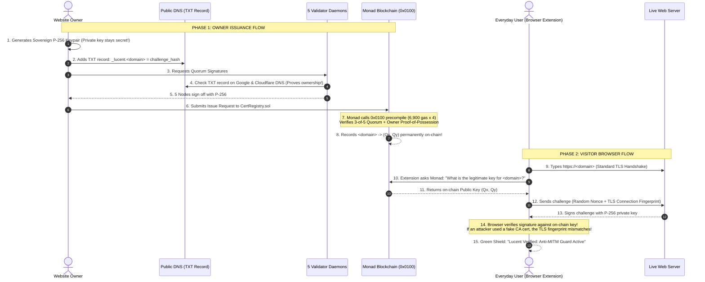

# Lucent
### Decentralized Public Key Infrastructure (dPKI) on Monad
*Eliminating Centralized CA Master Keys using Monad's Native P-256 (`0x0100`) Precompile*

**Monad Blitz Devcon Mumbai Hackathon Project**
* **Project Name:** Lucent
* **Blitz Portal:** [blitz.devnads.com](https://blitz.devnads.com)
* **GitHub Repository:** [https://github.com/NVN404/Lucent](https://github.com/NVN404/Lucent)
* **Network:** Monad Testnet (`Chain ID: 10143`)
* **RPC URL:** `https://testnet-rpc.monad.xyz`
* **Explorer:** [testnet.monadscan.com](https://testnet.monadscan.com)

---

## Live Monad Testnet Deployment (Verified On-Chain)

Both smart contracts are **broadcast, verified, and confirmed on Monad Testnet**:

| Contract / Entity | Address | Deployment Tx Hash | MonadScan Explorer Link |
| :--- | :--- | :--- | :--- |
| **`CertRegistry`** | `0xE4ec4B30F417260cf0C3cdca8fbEAE6d337c080b` | `0x7b477f7f68534308071af997ab0b545c2fbede2fbe9a14f9ec564b844fe2b941` | [View on MonadScan](https://testnet.monadscan.com/address/0xE4ec4B30F417260cf0C3cdca8fbEAE6d337c080b) |
| **`ValidatorRegistry`** | `0x9854f6f7bc90A0D84dce9065E1bD3ae3B8d436E4` | `0x24996a10d45a55b2506763305d00923ab57e2a6e835de0ad1c90496703bd25ee` | [View on MonadScan](https://testnet.monadscan.com/address/0x9854f6f7bc90A0D84dce9065E1bD3ae3B8d436E4) |
| **Deployer Wallet** | `0xd886168001663855a8f1ea7DdEa1393A074Ee354` | — | [View on MonadScan](https://testnet.monadscan.com/address/0xd886168001663855a8f1ea7DdEa1393A074Ee354) |

* **Quorum Configuration:** **3 of 5** active P-256 validators
* **Precompile Address:** **`0x0000000000000000000000000000000000000100` (`0x0100`)**
* **Gas Consumption:** Exactly **6,900 gas** per verification (EIP-7951 standard on Monad)
* **Total Issuance Cost:** 4 checks $\approx 27,600$ gas ($<\$0.0001$ per certificate) with sub-second finality.

---

## The Incident & Motivation
Traditional Web PKI concentrates global internet trust in ~150 Certificate Authorities (CAs). The **eMudhra incident** exposed the core vulnerability of this architecture: an operational flaw during an HSM key wrap/unwrap ceremony generated weak intermediate CA private keys that remained undetected for ~18 months through multiple audit cycles.
* When a CA's master signing key is compromised or weak, fraudulent certificates can be forged for any domain worldwide.
* Traditional revocation mechanisms (CRLs and OCSP) are broken, slow to propagate, and compromise user privacy.
* Certificate Transparency (CT) logs are strictly *reactive* (they detect misissuance after the fact), not preventative.

## The Solution: Lucent
**Lucent eliminates the single CA master signing key.**
Instead of trusting a single organization's private key, certificate issuance and revocation are governed by an on-chain **3-of-5 independent validator quorum**, cryptographically enforced on Monad using its native secp256r1 (NIST P-256) precompiled contract at `0x0100` (EIP-7951).



---

## Key Architectural Invariants

1. **Native Monad P-256 Precompile (`0x0100`):**
   * Uses Monad's EIP-7951 precompile at `0x0100` costing **6,900 gas** per verification.
   * Full 3-of-5 validator quorum + 1 owner Proof-of-Possession verification = **4 calls $\approx 27,600$ gas total**, executing in sub-seconds.
2. **Explicit Public Key Coordinates (No Address Extraction):**
   * Precompile `0x0100` takes `(hash, r, s, qx, qy)` and outputs `1` or `0`. `ValidatorRegistry.sol` directly stores the validator set's P-256 `(bytes32 qx, bytes32 qy)` coordinates.
3. **Strict Low-$s$ Invariant:**
   * Solidity layer enforces $0 < s \le \lfloor n / 2 \rfloor$ before calling `0x0100`, eliminating signature malleability.
4. **Anti-Name Squatting & Atomic Domain Binding:**
   * Domains are not pre-registered. Domain binding and certificate issuance occur in a single atomic transaction upon multi-validator quorum proof.
5. **Deterministic DNS Challenge:**
   * Value derived as: `sha256("MONADTRUST_DNS_CHALLENGE_V1" || chainId || subjectKeyHash || nonce)`. A challenge cannot be recycled for another key or request.
6. **Live Anti-Relay Handshake:**
   * When an auditor/client connects to the website, the server signs `(tls_cert_fingerprint || client_nonce || timestamp)` with its P-256 key. An attacker proxying traffic with a rogue TLS cert cannot relay the signature because their TLS certificate fingerprint will mismatch!
7. **No Admin Master Key (Timelocked Governance):**
   * `ValidatorRegistry` contains no instant admin backdoors. All validator updates and quorum parameter changes pass through a configurable **Timelock** controlled by a **3-of-5 Validator Governance Multisig**.

---

## Validator Daemon Performance & Specs

* **RAM Footprint:** **~7.3 MB RSS** per validator node.
* **All 5 Nodes Running:** **~37 MB total RAM**.
* **Binary Size on Disk:** **5.1 MB** (`monadtrust-validator`).
* **CPU Usage:** **<0.1%** during idle and signature verification.
* **Minimum System Specs:** 1 vCPU, 64 MB RAM, 50 MB disk, 10 Mbps network.

---

## Repository Structure

```
lucent/
├── contracts/               # Foundry smart contract suite
│   ├── src/
│   │   ├── P256.sol         # Low-level 0x0100 precompile caller + low-s & curve guards
│   │   ├── ValidatorRegistry.sol # 3-of-5 P-256 validator storage + Timelocked governance
│   │   └── CertRegistry.sol # Atomic issuance, PoP, sequential nonces, sovereign revocation
│   ├── script/
│   │   └── Deploy.s.sol     # Live deployment script for Monad Testnet (Chain ID 10143)
│   └── test/
│       └── CertRegistry.t.sol # 13 Foundry tests (9 invariant unit + 4 fuzz suites, 100% pass)
├── crates/
│   ├── common/              # Shared cryptographic types, canonicalization & pre-hash routines
│   ├── validator/           # Multi-source DNS-01 verification & P-256 signing daemon
│   ├── cli/                 # Domain owner ACME-style CLI (keygen, challenge, quorum requester)
│   └── verifier/            # Client verifier & live TLS anti-relay handshake auditor
├── frontend/                # Interactive React / Tailwind Web Dashboard
└── scripts/
    ├── simulate_network.sh  # Launches 5-node simulated validator network
    ├── stop_network.sh      # Cleanly shuts down daemon processes
    ├── deploy_testnet.sh    # Deploys smart contracts to Monad Testnet
    └── demo.sh              # 1-click end-to-end hackathon demonstration
```

---

## Running the Demo

### Option 1: Interactive Web Dashboard
```bash
npm run dev --prefix frontend
```
Open **`http://localhost:5173`** to test:
* Instant sovereign key generation and deterministic DNS-01 challenge.
* Strict public DNS check vs Sandbox instant registration.
* Real-time 5-node validator quorum signing.
* On-chain issuance with live MonadScan explorer links.
* Live anti-relay TLS handshake probe & sovereign revocation.

### Option 2: 1-Click Terminal Demo
```bash
./scripts/demo.sh
```

---

## Monad Blitz Devcon Mumbai Submission Reference
* Initial fork: [monad-developers/monad-blitz-devcon-mumbai](https://github.com/monad-developers/monad-blitz-devcon-mumbai)
* Repository: [NVN404/Lucent](https://github.com/NVN404/Lucent)
* Blitz Portal: [blitz.devnads.com](https://blitz.devnads.com)
